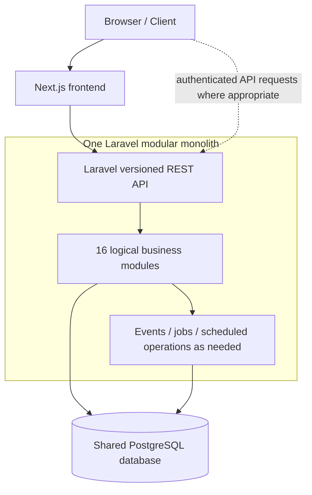

# ADR-001 — Adopt Modular Monolith Architecture

- **Status:** Accepted (architecture baseline approved in the development roadmap; this record documents that decision)
- **Recorded:** 2026-11-25
- **Scope:** University v1 backend architecture
- **Phase:** 00 — Architecture & Foundation / 00.04
- **Supersedes:** None

## Context

University is a university management and training system and a public technical-lead portfolio project. Its approved scope includes 16 logical modules across identity, authorization, academic administration, enrollment, tuition, classroom, assessment, publication, commerce, CMS, support and notifications. Delivery is incremental: the academic core at v0.1.0 and the agreed full scope at v1.0.0.

Several workflows cross business boundaries. Enrollment requires authoritative academic eligibility, prerequisite history, tuition status, schedule and capacity checks. Checkout and returns interact with inventory, payment state and seller accounting. Critical invariants require consistent mutations under concurrent requests, while notifications and other side effects may be asynchronous.

The current project has one primary developer, a Laravel 13 / PHP 8.4 backend, Next.js 16 frontend, PostgreSQL, and an existing Docker/GitHub Actions/GHCR baseline. Live VPS deployment is conditional on infrastructure availability. There is no demonstrated need for independently deployed business services or independent scaling of individual modules at this stage.

## Decision drivers

- Maintain explicit business ownership and manageable dependencies as the product grows.
- Preserve strong local transactional consistency for academic and financial invariants.
- Keep development, testing, deployment and operational complexity proportionate to the team and project maturity.
- Support incremental delivery, automated verification, measurable performance improvements and understandable code.
- Reuse the existing stack and delivery baseline rather than rebuild working infrastructure.
- Preserve the option to evolve architecture later without designing for hypothetical scale now.

## Alternatives considered

| Alternative | Benefits | Costs and limitations in this project |
|---|---|---|
| Traditional layered monolith without explicit business-module boundaries | Simple initial implementation and deployment; local SQL transactions; familiar Laravel conventions | Business responsibilities may become scattered across technical layers; cross-feature coupling becomes harder to govern as the scope grows. This is a risk of weak boundaries, not an inherent limitation of monoliths. |
| Modular monolith | Explicit logical business boundaries and ownership; one backend deployment; local transactions; low network and operational overhead; incremental implementation | Requires boundary discipline, reviewed contracts and dependency management; one backend release and shared database create coupling at deployment and resource levels; modules do not scale independently by default. |
| Microservices | Independent deployment and potentially independent scaling and team ownership; stronger process isolation when designed accordingly | Adds network failures, service authentication, distributed consistency, contract/version management and operational burden. Independent services and data ownership would complicate critical cross-module workflows; no demonstrated need justifies the cost for v1. |

The comparison is qualitative and specific to the current scope/team, not a benchmark or universal ranking.

## Decision

Adopt a **Modular Monolith** for the University backend through v1:

1. Run one Laravel business application with one shared PostgreSQL database; keep the Next.js frontend as a separate application communicating through the versioned REST API. One backend application may have separate web, queue-worker and scheduler processes/containers; these are not independently owned domain microservices.
2. Maintain the approved 16 logical business modules with explicit responsibilities, data ownership and application-facing contracts. See the proposed detailed [module boundary design](../architecture/module-boundaries.md); this ADR accepts the architectural style, not every still-proposed detail of that document.
3. Keep business rules and writes within the owning module. Cross-module operations use explicit public queries/commands or coordinated application workflows. Avoid direct circular dependencies and unauthorized cross-owner writes. Shared PostgreSQL foreign keys and deliberate, authorized read-only joins/projections are permitted.
4. Use database constraints and appropriately coordinated local transactions for critical invariants. Do not rely on asynchronous events alone for capacity, payment confirmation, stock, entitlements or ledger consistency. Independent side effects may use events/listeners/jobs after commit; delivery guarantees and retries are addressed where required.
5. Use pragmatic Laravel conventions, with layered architecture and DDD-Lite as the approved direction. Exact physical module layout, dependency direction within layers, and abstraction choices will be documented separately. Do not introduce generic repositories, full CQRS, event sourcing or distributed business services as baseline requirements.
6. Keep existing `api/`, `front/`, `docker-setup/` and CI/CD structure unless a reviewed change is necessary. Maintain the mandatory test-as-you-build policy for both frontend and backend.

### Logical architecture

This is a logical illustration, not the final Nginx routing, authentication topology or deployment diagram. Workers represent processes of the same application. The exact module dependency graph belongs to the module-boundaries document.

## Consequences

### Positive

- Fewer deployment and network boundaries to manage during incremental delivery.
- Local transactions can protect critical multi-owner operations without requiring distributed transaction protocols.
- A shared relational database supports efficient joins, constraints and deliberate read projections.
- Explicit ownership provides a basis for focused implementation, review, testing and future evolution.
- Existing Docker and CI/CD work remains useful; complexity can grow in response to measured needs.

### Negative and trade-offs

| Trade-off | Mitigation |
|---|---|
| Backend modules share a deployment and rollback boundary | Keep PRs small, maintain compatible migrations, verify critical regression and deployment smoke tests; application rollback does not automatically reverse database migrations. |
| Shared database and application resources can create contention and broad impact | Use measured query/index tuning, appropriate constraints, short transactions, consistent locking, and resource monitoring. Separate workloads or scale the whole backend when justified. |
| Logical boundaries can erode without process isolation | Review module ownership and imports; document allowed dependencies and public contracts; add architecture checks when the physical layout and risks justify them. |
| Cross-module workflows add coordination complexity | Keep coordinators focused on orchestration, retain owner rules, and test atomicity and failure cases. Avoid generic orchestration frameworks. |
| Side effects may be lost or duplicated despite post-commit dispatch | Design retry-safe consumers and introduce durable delivery/reconciliation where the required guarantees justify it. |
| Individual modules cannot be released or scaled independently by default | Measure actual bottlenecks and consider targeted extraction only when simpler remedies are inadequate. |

## Validation and acceptance evidence

This record defines design intent; it does not claim the architecture is already implemented or production-ready.

- Review the module boundary map and dependency graph before implementing new module relationships.
- Check each slice for owner-controlled mutations, server-side authorization, documented dependencies and appropriate constraints/transactions.
- Write or update meaningful frontend/backend tests in the same implementation step and PR. Verify cross-module contracts, failure/rollback behavior and relevant scope violations.
- Run PostgreSQL-specific integration and concurrency tests for critical invariants; SQLite alone is not sufficient evidence.
- Verify required CI checks, production builds and relevant Docker smoke tests before release/merge as applicable. Record measured query, performance and concurrency results, not presumed benefits.
- Keep ADRs, domain models and module boundaries aligned as decisions evolve.

Existing foundation observations remain separate from the architecture selection: Docker test-environment isolation and `.env.testing` handling require a permanent solution; the latest frontend production build was attempted in a development container and has not yet been revalidated in the production build environment. These are tracked for foundation verification, not proof of an architectural defect.

## Revisit triggers

Reassess this decision when evidence shows that the existing design no longer meets requirements, for example:

- A measured bottleneck requires independent scaling or workload isolation that simpler tuning or process separation cannot adequately address.
- Independent team ownership and release cadence become a sustained business requirement.
- A concrete security, regulatory, availability or blast-radius requirement demands stronger runtime or data isolation.
- Release coordination or resource contention repeatedly causes unacceptable outcomes despite reasonable mitigations.

No arbitrary user-count or traffic threshold is assumed. Evaluate benefits, migration cost, consistency requirements and operational capacity before extracting any service. Record an accepted replacement in a new ADR and link it from this record as `Superseded` rather than silently rewriting history.

## Related decisions not finalized by this ADR

Detailed layered/DDD-Lite organization, role and program-scoped authorization representation, PostgreSQL persistence conventions, Sanctum/session topology, enrollment locking and concurrency, financial idempotency and transaction design, event delivery guarantees, CMS blocks and Reverb/WebSocket authorization will receive their own records when their choices are sufficiently defined. Open business decisions (OD-001–010) remain governed by the requirements documents and roadmap. No schema, class, namespace or package installation is required by this documentation step.

## References

- [Development roadmap](../university-roadmap.md)
- [Project scope](../requirements/project-scope.md)
- [Business rules](../requirements/business-rules.md)
- [Module boundaries — proposed detailed design](../architecture/module-boundaries.md)
