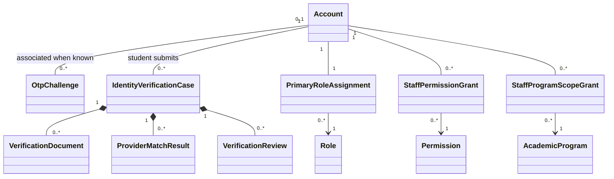
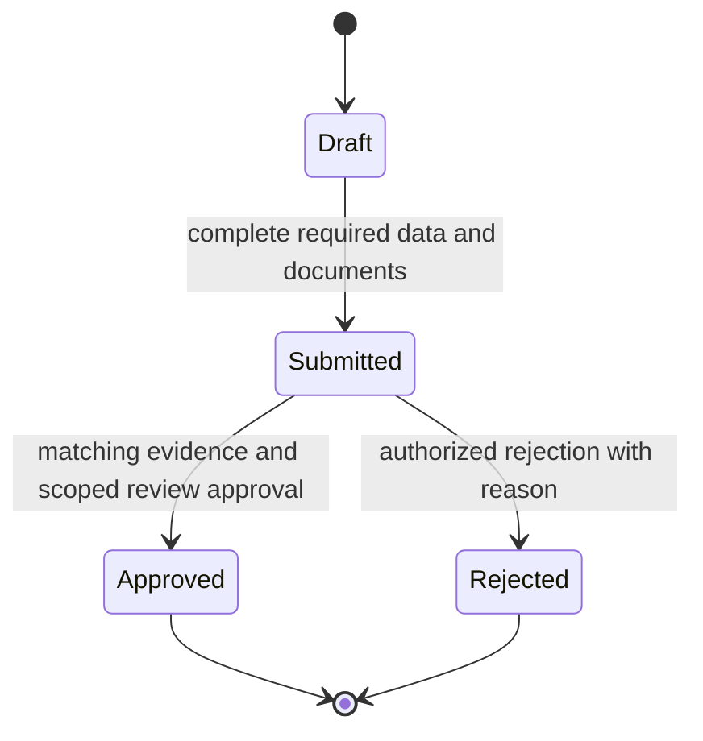

# University — Identity & Authorization Domain Model

- **Baseline:** University Architecture v1.0
- **Phase:** 00 — Architecture & Foundation / 00.05
- **Status:** Proposed domain design for review; not a physical schema or implementation
- **References:** [Business rules](../requirements/business-rules.md), [Project scope](../requirements/project-scope.md), [Module boundaries](module-boundaries.md), [ADR-001](../adr/0001-adopt-modular-monolith.md), [Roadmap](../university-roadmap.md)

## 1. Purpose and language

This document models Identity and Authorization business concepts before the logical/physical ERD. The approved rules are normative; names, aggregate boundaries, lifecycle labels and new security mechanisms below are design proposals unless explicitly marked confirmed. No table, identifier type, column, PHP class, endpoint or package is prescribed. Use pragmatic DDD-Lite and Laravel conventions; not every conceptual object needs its own class.

| Term | Meaning |
|---|---|
| Account | A principal with a stable identity, contact identifiers and authentication lifecycle. |
| Mobile verification | Proof of control of a mobile number at a point in time. Not proof of legal identity. |
| Identity verification | Student national-ID/mobile matching and authorized Education review of identity/diploma documents. |
| Primary role | Exactly one of the six approved account categories. Not an account state or verification result. |
| Permission | A named capability to perform an operation; staff grants are granular. |
| Program membership | Student or teacher academic affiliation owned by Academic. |
| Staff program scope | Authorization grant delimiting which programs a staff member may operate on. Not academic membership. |
| Resource authorization | Decision combining authenticated actor, role, effective permission, scope/ownership and resource state. |

## 2. Boundaries and model inventory

| Owner | Concept | Classification / responsibilities |
|---|---|---|
| Identity | Account | Entity / proposed aggregate root: contact identifiers, credentials and account lifecycle; no role-grant mutations. |
| Identity | Credential | Account-owned security data, including password hash when configured; session management via framework infrastructure. No plaintext passwords. |
| Identity | MobileNumber, EmailAddress, NationalId, BirthDate | Candidate value objects; normalize and validate where relevant; do not add wrapper classes unless useful. Format validation is not proof of identity. National ID is text, not a numeric quantity. |
| Identity | OtpChallenge | Entity / proposed separate aggregate root: purpose, destination, expiry, attempts and one-time consumption. Separate lifecycle from Account, including pre-registration challenges. |
| Identity | IdentityVerificationCase | Entity / proposed aggregate root: submitted identity facts, program-routing reference (OD-001), provider outcome and review lifecycle. |
| Identity | VerificationDocument | Case-owned entity: required document kind (national ID image, latest diploma image), protected storage reference and submission version; no public URL. |
| Identity | ProviderMatchResult | Case-owned evidence/value-like record: outcome, provider, checked time and reference, bound to the submitted identity facts. Do not expose unnecessary raw provider payloads. |
| Identity | VerificationReview | Case-owned review record/entity: reviewer reference, decision, reason and time. Keep historical decisions; a new submission must not silently overwrite old evidence. |
| Authorization | Role | Reference entity; fixed six primary role codes for v1. |
| Authorization | PrimaryRoleAssignment | Logical account-to-role association owned by Authorization; exactly one role for each provisioned account. Physical representation deferred. |
| Authorization | Permission | Reference entity defining an operation; exact keys and role/permission matrix in day 3. |
| Authorization | StaffPermissionGrant | Logical grant of an eligible capability to a staff account; exact grant/default/override model open. |
| Authorization | StaffProgramScopeGrant | Logical association of staff and Academic Program; exact cardinality and whether permission grants vary by program are open (OD-002). |
| Academic | AcademicProgram, StudentProgramMembership, TeacherProgramAssignment | External domain references only; Academic owns affiliation, history and valid program definitions. |

Provider adapters, SMS transport, file storage, session cookies, CSRF and framework policies are infrastructure/application concerns, not additional domain aggregates. Identity owns OTPs; ordinary Notification records never contain OTP secrets. Authorization may query Identity; Identity must not import Authorization. Application workflows compose both and Academic when necessary.

Conceptual associations, not table relationships. Zero or more scope grants is illustrative of a grant collection; actual allowed scope cardinality and required grants are not approved. Pre-account OTPs do not require an Account. Only student accounts enter the student identity-case workflow in v1; the diagram does not imply teachers/staff follow it. Required document completeness is enforced at submission, not at draft creation. The account-to-role relation is an invariant across owners, not a mandate for a separate assignment table.

## 3. Identity domain invariants and workflows

### 3.1 Account and authentication

- **Confirmed BR-IDN-001/002:** exactly one role for every provisioned account: Student, Teacher, Education, Store Management, Site Admin (CMS), Support. Public registration always creates a Student; never accept a caller-selected privileged role. Teachers are created by authorized Education; staff provisioned by controlled administrative process (OD-001).
- **Confirmed BR-IDN-003:** login by mobile OTP or email/mobile plus password; student registration includes mobile OTP verification. Registration proof and login challenge are separate purposes; contact verification does not grant academic identity approval.
- **Proposed:** stable account identity, normalized unique login identifiers for each identifier type when present, no ambiguity in lookup. Email requiredness/verification and password setup/recovery for each role remain open. Verify possession before binding or changing mobile; decide contact change/re-verification behavior before implementation. Do not make password nullable/mandatory in schema until credential rules are settled.
- **Proposed:** separate account availability (e.g. Active/Suspended) from mobile verification and student identity approval. An active unverified student can authenticate and access explicitly allowed onboarding actions; enrollment requires approved identity and all other BR-ENR-001 conditions. Other pre-approval feature access remains open. Suspension/recovery and session revocation semantics require approval before implementation.
- Keep passwords hashed with the framework; issue and revoke secure first-party sessions using the chosen Sanctum baseline. Rate-limit login/recovery and avoid exposing whether accounts exist where that creates enumeration risk. No live provider claims from mock behavior.

### 3.2 OTP challenge

Proposed lifecycle: Issued -> Consumed, Expired, or Invalidated (attempt limit, resend or explicit cancellation, as policy specifies). Terminal challenges cannot be reused. A successful verification consumes the challenge atomically; competing requests must not both succeed. Bind it to normalized destination, intended purpose and account or pre-registration context. Enforce expiry and attempt/rate limits server-side, including resend; protect stored secret with a suitable keyed verifier and avoid logging or broadcasting codes. Numeric limits, resend invalidation and recovery rules are open engineering policy details. Wrong codes must not authenticate or mark mobile verified; provider failure is not successful verification.

### 3.3 Student identity verification

Confirmed BR-IDN-004/005/006: use national ID, birth date, mobile, national ID image and latest diploma image; national-ID/mobile matching plus authorized Education manual review; record decision/reasons; keep documents private. API.ir credentials/access are not verified. A fake adapter may supply explicitly simulated results in dev/test, not real assurance.

Proposed lifecycle: Draft -> Submitted -> Approved or Rejected, with provider status tracked independently (NotChecked, Matched, Mismatched, Unavailable/Error). A submission can be reviewed while match work is pending; approval must require both valid matching evidence and authorized document approval. Unavailable/mismatched provider result is not approval; no production fallback bypass is assumed. Determine handling/manual fallback with user before live use. A rejected case may lead to a new version/case if resubmission is allowed; preserve prior review history. Exact resubmission and expiry/reverification rules remain open. Proposed initial program request before review routes to Education; do not create an active academic membership merely because a program was requested (OD-001).

Provider outcome is orthogonal to case status. Match evidence must correspond to the reviewed submission; changed facts invalidate stale evidence. Do not hold database transactions open during provider calls or document uploads. Recheck actor authorization, case status and evidence version when finalizing; concurrent reviewers must not silently overwrite a final decision. File access must be authorized per case and action; validate type/size/content, store privately, avoid public storage links and sensitive audit payloads. Exact retention/deletion policy remains open. Reviewer identity, decision, time and reason must be traceable; rejection reason required, approval reason policy to be finalized.

### 3.4 Provisioning workflow

The application workflow resolves and validates the Student role through Authorization before creating the Identity account with its mandatory role ID. Account provisioning and applicable OTP proof consumption are coordinated within one local transaction. No roleless account may be inserted, and failed provisioning must not leave inconsistent records.

1. Public registration verifies a purpose-bound mobile challenge and validates contact/credential input; server chooses Student.
2. Application workflow creates Identity account and Authorization primary-role assignment within one local transaction. Failure rolls back both; no externally usable roleless account. OTP proof consumption and replay protection are coordinated so registration cannot be repeated with the same proof.
3. Student authenticates and completes onboarding/verification; proposed initial program request is validated with Academic before scoped Education review. Academic membership activation is a distinct operation; exact timing/approval semantics OD-001.
4. Teacher creation requires an authorized, in-scope Education actor and valid program reference, then coordinated Identity, Authorization and Academic changes. No teacher public signup. Staff bootstrap is controlled; no public privilege escalation. Teacher initial credentials/invitation method is open.

## 4. Authorization domain invariants

Confirmed BR-IDN-001, BR-AUT-001/002: exactly one primary role, granular staff permissions, Education/Support program scopes, server-side enforcement. Role assignment, permission and scope grants are owned by Authorization. Academic membership cannot grant staff rights. Each resource owner implements domain-specific constraints through policies/use cases; Authorization supplies common access facts. Deny by default if required information/grant is absent; UI restrictions are not authorization.

| Role | Broad intent (not final permission matrix) |
|---|---|
| Student | Own onboarding, academic enrollment/class participation, permitted publications, purchases/support. |
| Teacher | Authorized class/assessment operations, own publications and eligible program books, purchasing/support. |
| Education | Authorized academic management and review, limited by permissions and relevant program scope. |
| Store Management | Authorized catalog/inventory/commerce/settlement operations; no implied access to identity documents or grades. |
| Site Admin (CMS) | Authorized page/content management, not a global super-admin. |
| Support | Authorized program-scoped tickets/chat; not academic or finance approval. |

Proposed access decision sequence: authenticate principal -> ensure account usable -> verify role eligibility -> check relevant capability/permission -> verify resource program/ownership -> apply domain-state constraints. For a staff action needing both a permission and a program grant, both must apply to the same action/resource; never combine grants across different scopes in a way that broadens access. For students/teachers, ownership/membership and state checks are required where appropriate, not blanket staff grants. Public routes have explicitly defined public projections; all other access is denied by default. No implicit cross-program/global access for missing scope. Role changes, permission delegation, grant expiry/defaults and scope representation remain open.

| Actor/action (illustrative) | Result assuming stated facts |
|---|---|
| Education with review capability, assigned program A, case routed to A | Eligible to review; matching and case state still govern approval. |
| Education with review capability, only program B, case routed to A | Deny. |
| Education with program A but no review capability | Deny. |
| CMS staff with page-publish capability attempting identity document access | Deny. |
| Student authenticated but identity not approved attempting enrollment | Deny under BR-ENR-001. |
| Student requesting another student's private documents | Deny. |

## 5. Candidate events and service boundaries

Illustrative names only, not mandatory implementation classes: `AccountRegistered`, `MobileVerified`, `StudentIdentitySubmitted`, `StudentIdentityVerified`, `StudentIdentityRejected`, `StaffPermissionChanged`, `StaffProgramScopeChanged`. Publish side-effect events after successful commit; carry minimal IDs and necessary nonsecret metadata. No OTP, credential hash, national ID, birth date or document content in ordinary events. Do not rely on eventual events to enforce current access or complete atomic role/account assignment. Define retries and notification delivery where needed.

Application use cases include RegisterStudent, AuthenticateWithPassword, RequestOtp, VerifyOtp, SubmitIdentityVerification, ReviewIdentityVerification, ProvisionTeacher and ManageStaffGrants. These names illustrate responsibilities, not predetermined class names. External national-ID/mobile verification uses an adapter contract and fake provider; keep provider calls out of entities. Authentication/authorization implementation ADRs, physical module layout and API contracts follow later.

## 6. Traceability and future acceptance tests

| Reference | Candidate automated acceptance evidence (when implemented) |
|---|---|
| BR-IDN-001/002 | Exactly one role after provisioning; rollback on assignment failure; public teacher/staff role injection denied; out-of-scope teacher creation denied. |
| BR-IDN-003 | Password login by eligible identifiers; OTP expiry, wrong purpose, replay/concurrent consume, rate limits, wrong code and frontend form behavior. |
| BR-IDN-004/005/006 | Required data/documents; matched + authorized approval; mismatch/unavailability; stale evidence; out-of-scope review/file access; concurrent finalization; fake provider explicitly isolated. |
| BR-AUT-001/002 | Role/permission/scope combinations; missing scope denies; cross-program isolation; direct API access denied despite UI manipulation; revoked grants respected. |
| BR-ACD-002/003 | Academic program affiliation and history owned by Academic; no implicit staff scope from membership. |
| BR-ENR-001 | Mobile verified but identity unapproved cannot enroll; approval alone is insufficient without other enrollment conditions. |
| BR-XCT-001/002 | Private document storage/access, preserved review history, audit without sensitive secrets. |

These are future test requirements, not executed tests. Add or update backend and frontend automated tests in the same implementation step/PR; use PostgreSQL for constraints/transactions/concurrency, fake providers and synthetic data. Test authorization via backend/API and meaningful frontend behavior separately. No new application code in this documentation-only change.

## 7. Open decisions and handoff

| Decision | Status / timing |
|---|---|
| OD-001: initial program request, reviewer routing, when membership becomes active, privileged staff bootstrap and teacher credential setup | Proposed routing before review; resolve before Identity/Academic provisioning implementation. |
| OD-002: staff scope cardinality, permission-to-scope association and granting authority | Resolve with day-3 role/permission matrix before access implementation; no implicit global scope. |
| Account/contact policy | Required login identifiers, email verification, uniqueness of national ID across student accounts, account suspension/reactivation, role changes, credential reset and contact change behavior; resolve before related migrations/use cases. |
| Verification lifecycle | Resubmission, re-verification after contact changes, match failure/retry and any explicitly authorized real-world fallback, document retention and review reason requirements; no fallback assumed. |
| OTP policy | Expiry, attempt and resend limits, challenge invalidation, recovery and delivery policy; define before implementation. |
| OD-010: providers | API.ir/SMS access unverified; use explicit fake adapters only in allowed non-production contexts. |

Next: draft Identity/Authorization logical ERD with conceptual relationships, cardinalities, uniqueness/integrity and history constraints. Mark unresolved schema choices as provisional; no migrations until decisions needed for Phase 01 are reviewed. Role/permission matrix, physical layer organization, testing isolation and remaining ADRs are later foundation tasks. Update requirements and related ADRs if any proposed domain choice changes an approved rule.
