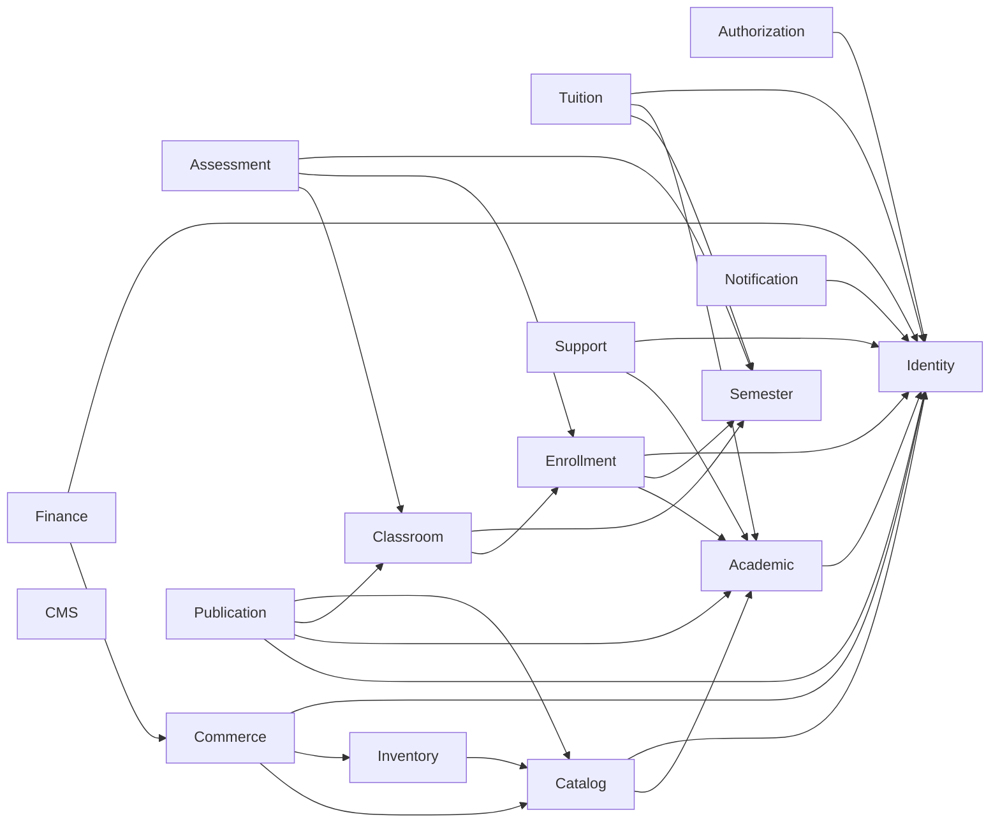
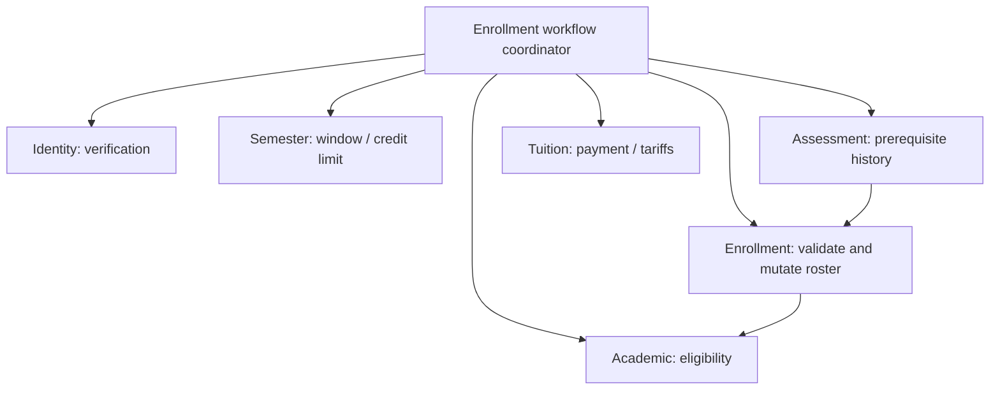

# University — Module Boundaries

- **Baseline:** University Architecture v1.0
- **Phase:** 00 — Architecture & Foundation / 00.03
- **Status:** Proposed design for review; not evidence of implementation
- **Related:** [Project scope](../requirements/project-scope.md), [Business rules](../requirements/business-rules.md), [Development roadmap](../university-roadmap.md)

## 1. Purpose and principles

University is one Laravel modular monolith with one PostgreSQL database and a separate Next.js client. The 16 logical modules have explicit business responsibilities, data ownership and public application contracts. The group names below are for communication, not deployment units or mandatory folders. Physical table names, PHP namespaces and frontend paths are deferred to subsequent foundation steps. No microservices, generic repository layer, event sourcing or mandatory message bus are introduced.

A module owns the rules and mutations of its data. Other modules may obtain necessary information through explicit owner-defined queries, commands or events. Database foreign keys across modules are allowed where they express real integrity constraints; shared storage is not permission to bypass an owner's write rules. A cross-module transaction may be coordinated in the application layer and is often preferable to eventual consistency for critical invariants. The database is not partitioned by module in v1.

## 2. Logical module ownership

Entities below are conceptual, not a migration specification. IDs refer to requirements in business-rules.md; the owner of a rule may coordinate with other owners to enforce it.

| Module | Owns (conceptual data and behavior) | Outside its boundary | Rule references |
|---|---|---|---|
| Identity | Accounts, credentials, mobile OTP challenges, identity verification cases, review outcomes and private identity documents; account provisioning and lifecycle | Roles/permissions, program membership and curriculum | BR-IDN-001–006 |
| Authorization | Primary role assignment, permission definitions/grants, staff program-scope grants; access decisions | Credentials, academic membership/history, domain state changes | BR-IDN-001, BR-AUT-001–002 |
| Academic | University, faculty, department, program, curriculum versions, course definitions, credits, prerequisite definitions, student program history and teacher program assignment | Semester dates, offering capacity, attendance and grades | BR-ACD-001–005 |
| Semester | Term codes, term lifecycle, academic windows, term credit limits | Tuition monetary tariffs and invoices, course registration | BR-SEM-001–003 |
| Enrollment | Term course offerings, teacher assignments to offerings, recurring schedules, eligible programs, capacity and registration records; eligibility, add/drop, withdrawal and roster membership | Course definitions, fees, grade records, actual class-session attendance | BR-ENR-001–008 |
| Classroom | Actual sessions, cancellations/makeup events, class announcements, exams as events, attendance, assignments, submissions, removal requests | Offering/roster mutations, final grades, tuition adjustments | BR-CLS-001–004 |
| Assessment | Final grades, publication, pass/fail, appeals, escalation, approved corrections and grade history | Assignment submissions, curriculum definitions and registration mutations | BR-ASM-001–003 |
| Tuition | Semester tariff amounts by category, fixed/variable invoices and payment attempts, monetary snapshots, tuition adjustments | Registration records, store orders, seller settlements | BR-SEM-003, BR-TUI-001–004 |
| Publication | Articles, moderation decisions, scheduling/publication and public-profile read composition | Author account, academic history and book source records; CMS page editing | BR-PUB-001–003 |
| Catalog | Product/category definitions, SKU, seller, prices, listing approval and product assets/metadata | Stock, orders, download purchase entitlement, seller balances | BR-CAT-001–003 |
| Inventory | Physical stock, movements, reservations, release/consumption, nonnegative stock invariants | Product descriptions/pricing, order state and payments | BR-INV-001 |
| Commerce | Cart, orders and item snapshots, store payment attempts, shipment/tracking, returns/refunds and digital purchase entitlement | Stock mutations outside Inventory contract, seller ledger, academic tuition | BR-COM-001–004 |
| Finance | Teacher-sale commission, seller ledger, pending/available balances, settlement requests and confirmations | Tuition billing, order lifecycle, stock and product catalog | BR-FIN-001–002 |
| CMS | Public pages, validated block settings/order, revisions, previews, publication and page SEO data | Article moderation, academic/financial records | BR-CMS-001–002 |
| Support | Program-routed tickets, assignments, messages, persistent chat conversations and status | Account lifecycle, notification delivery, academic approvals | BR-SUP-001–002 |
| Notification | In-app notification records, recipient/channel delivery attempts and delivery status, queued provider dispatch | Source business state, OTP challenges, support chat history | BR-NTF-001 |

### Explicit ownership decisions

- Identity owns account data; Authorization owns the single primary role assignment. Account creation and role assignment must be atomic, with no usable account without exactly one role. The physical representation (including whether the role is a foreign key on the account) is an ERD decision, not a requirement for separate tables.
- Academic owns academic membership, while Authorization owns staff grants for program scopes. A program membership does not itself grant staff permissions. Initial program requests and routing remain subject to OD-001; staff scope cardinality remains OD-002.
- Semester owns academic timing and credit limits; Tuition owns monetary tariffs keyed by semester. A semester settings screen can compose both without duplicating tariffs.
- Enrollment owns the official roster, including approved student removal and capacity release. Classroom owns removal requests and session attendance; Assessment owns grades. Historical records are retained and must not be erased by roster changes.
- Enrollment owns recurring offering schedules; Classroom owns actual sessions and makeup events. Conflicts spanning both must be checked through a coordinated workflow before changes commit; exact conflict/locking model remains for phases 02–04.
- Tuition and Commerce own distinct payment lifecycles. They may reuse a small gateway contract/adapter; Finance is not a general payment module and owns only seller accounting/settlement. Real payment integration is deferred.
- Catalog owns product assets; Commerce grants purchase entitlements; a protected download requires authorization and entitlement checking before the file is served. Public profile book metadata is an allowlisted projection, not public access to the storefront.
- Identity verification OTP is a security challenge, not an ordinary Notification record. Identity may use shared SMS transport; never expose OTP secrets in notification history or event payloads.
- Publication composes public profiles from approved fields of source modules; it does not copy or take ownership of private data. CMS owns pages, not articles.

## 3. Module dependency policy

A direct dependency means a module's application code calls another module's public application contract. The arrow `A → B` means A depends on B, not the direction of data flow. The proposed direct business graph below is deliberately acyclic. Common authenticated actor/policy checks are supplied at application entry points by Identity/Authorization and omitted from the diagram for readability. Authorization may consume an Identity account lookup; Identity does not directly depend on Authorization. Provisioning and program assignment checks use workflow composition. No module imports another module's private repositories, controllers, models as mutable business objects, or infrastructure implementations.

| Consumer | Allowed direct business providers (when needed) | Reason |
|---|---|---|
| Identity | None | Identity verification and account lifecycle |
| Authorization | Identity | Account identity lookup; program-scope checks composed with Academic |
| Academic | Identity | Validate account references |
| Semester | None | Term definitions and windows |
| Tuition | Semester, Academic, Identity | Tariff context, course categories, billed account |
| Enrollment | Academic, Semester, Identity | Curriculum, academic time, verification status |
| Classroom | Enrollment, Semester | Roster and term context |
| Assessment | Classroom, Enrollment, Semester | Authorized classroom and registration context, grade windows |
| Catalog | Academic, Identity | Teacher program eligibility and seller identity |
| Inventory | Catalog | Product identity and stock-managed product type |
| Commerce | Catalog, Inventory, Identity | Product snapshot, reservations, buyer identity |
| Finance | Commerce, Identity | Sale/refund facts and seller identity |
| Publication | Identity, Academic, Classroom, Catalog | Approved author/profile, eligible class history, book metadata |
| CMS | None | Independent content rules |
| Support | Academic, Identity | Program routing and participant identity |
| Notification | Identity | Recipient contact/channel lookup; delivery is triggered by event consumers |

This is a proposed allowlist, not a mandate to create every dependency immediately. An additional dependency requires review of the rule, coupling and graph. Shared authorization checks, framework infrastructure and event subscription wiring are not direct business-module edges. Domain-specific policy decisions still belong to the relevant resource owner. For public profiles, request minimal allowlisted projections, not raw records.

## 4. Cross-module workflows and circular dependency avoidance

Use a small application-level workflow coordinator where an invariant spans multiple owners and direct dependencies would be cyclic. A coordinator is composition of existing public contracts, not a seventeenth domain module, a generic service bus or a second implementation of owner rules. Its final placement will be decided with the Laravel structure. It can invoke participating modules inside a single database transaction; owners must expose operations suitable for that transaction, without independent commits or premature external side effects. The coordinator must use trusted server-derived facts, not caller-supplied authorization, grades, price or payment status.

### Account and primary role

Provisioning workflow resolves and validates the primary role through Authorization before invoking Identity to insert the account with its required role ID. Related provisioning operations are coordinated within a single database transaction.

### Enrollment, grades and tuition

An enrollment workflow obtains verified identity, academic eligibility, semester windows, authoritative Assessment prerequisite history, Tuition fixed-payment state and Enrollment schedule/capacity/current selections. It invokes Enrollment's rules and mutation inside an appropriate transaction. Enrollment does not directly import Assessment or Tuition; both can participate through coordinator calls. Prerequisite history, capacity, credit count, conflicts and other mutable facts must be checked under the chosen concurrency strategy, not assumed from stale UI data or asynchronous events. Actual lock order/isolation and concurrent grade-change semantics are to be defined in the enrollment ADR. Tuition calculates variable fees from trusted enrollment selections and applicable tariffs; final registration is coordinated with confirmed payment. Add/drop and approved classroom removal coordinate Enrollment and Tuition and retain historical Classroom/Assessment records. Refund/nonpayment and dependent-removal details remain open (OD-005/006).

### Checkout, inventory and finance

Commerce calls Catalog and Inventory for current prices and reservation operations. A payment/return workflow coordinates Commerce order state, Inventory reservation/stock mutations and Finance seller ledger entries when those effects must be atomic. Finance may read immutable Commerce sale/refund facts; Commerce must not import Finance to mutate seller balances. Verify payment callbacks and enforce idempotency in the relevant owner/workflow. Never hold a DB transaction open while calling an external payment provider; separate durable local state transitions from remote calls, with replay-safe confirmation/reconciliation. Commission rounding, return windows, cart policy and settlement eligibility remain open (OD-009).

### Class sessions and assessment

Classroom reads Enrollment membership for attendance/submissions; Assessment reads registration and classroom context for grade permission. Teacher-requested removal is reviewed by authorized Education, then an application workflow changes Enrollment membership and related tuition state. Neither Classroom nor Assessment writes another module's records directly. Makeup/recurring scheduling changes use the same coordinated invariant checks where their time ranges interact.

## 5. Inter-module communication

| Method | Appropriate use | Example |
|---|---|---|
| Synchronous query | Current fact required for a decision | Academic curriculum eligibility; published grade history |
| Synchronous command | Business operation whose outcome is needed immediately | Reserve inventory, create tuition invoice |
| Application workflow + database transaction | Cross-owner operation requiring consistent state | Enrollment/final registration, payment confirmation, refunds |
| Domain/application event after commit | Independent side effects that do not decide a critical invariant | Send enrollment confirmation; notify about grade publication |
| Owner-defined read projection/query | Efficient cross-module screens and reports, including reviewed SQL joins | Student dashboard or public profile |

Potential event names (illustrative, not required classes): `StudentIdentityVerified`, `EnrollmentConfirmed`, `GradePublished`, `ArticlePublished`, `OrderPaid`, `SupportMessageCreated`. Sources own event semantics; Notification subscribes through application wiring. Persist support chat before broadcasting to an authorized private channel. Dispatch relevant jobs/listeners after successful commit; consumers must tolerate retry and duplicate delivery. After-commit dispatch alone is not a durable outbox; use a durable delivery/recovery mechanism if guaranteed delivery becomes a requirement. Capacity, payment confirmation, entitlement and ledger integrity must not depend solely on eventual notification/event processing.

## 6. Data access and shared concerns

- Prefer Eloquent in ordinary owner-local persistence. Do not add repositories, interfaces or DTOs for every table by default. Explicit contracts can be concrete application actions/query classes with typed input/output; introduce abstractions only when justified.
- Cross-module foreign keys and PostgreSQL constraints are appropriate; document their lifecycle/delete behavior. Never cascade-delete academic/financial history casually. Exact physical model follows the ERDs.
- Cross-module read joins are allowed for deliberate read-only projections/reporting or owner-approved queries, with server authorization, minimal selected fields, and performance review. This is not permission to perform direct cross-module writes or bypass policies. Avoid N+1 calls by using batched queries/projections.
- Shared infrastructure: correlation IDs, standardized API errors, secure storage primitives, logging/audit mechanisms, time/money helpers where truly common, provider transport adapters and transaction support. Business-specific audit facts and authorization remain owned by each module. Avoid an unrestricted `Common`/`Helpers` dumping ground. A shared kernel, if needed, contains stable small concepts with no feature dependencies; do not build it preemptively.
- Within modules prefer pragmatic layering (HTTP → application use cases → business rules/domain; framework persistence details are infrastructure where separation pays off). Do not expose Laravel controllers as inter-module APIs; the Next.js client uses versioned REST endpoints, not PHP internal contracts. Frontend features map to business capabilities, but need not mirror backend modules one-to-one; exact structure is decided later.
- Sensitive identity documents, grades, attendance, private messages, and digital files must be explicitly protected. Authorization is enforced server-side and scoped to resource/actor, not just menu visibility. Cross-module reads must not expand privileges.

## 7. Validation and change control

For each slice/PR, check ownership of every mutation, approved dependency direction, absence of circular imports, transaction consistency, authorization, and minimal event payloads. Add or update appropriate automated tests alongside all new or changed behavior in both frontend and backend. Test owner invariants, cross-module contracts, workflows (including rollback), scope violations, concurrent conflicting mutations and idempotent effects as applicable. Use PostgreSQL for actual DB-specific behavior and concurrency tests; use fake external providers and synthetic data. Introduce automated boundary enforcement only if justified by the chosen physical layout and actual risks. No new code/tests are included in this documentation-only step.

## 8. Open decisions and next steps

- OD-001/002: initial program request and staff provisioning/scope cardinality, shared class ownership and code scope; resolve before relevant Identity/Authorization/Academic implementation.
- OD-003/004: time/window semantics and tuition tariff scope; refine in Semester/Tuition model.
- OD-005/006/007: payment deadlines, dependent-course removal, tuition adjustment and appeal windows; resolve before affected behavior.
- OD-008/009/010: public allowlist, commerce policies and external provider availability; retain as open.
- Confirm the proposed ownership split, dependency allowlist and workflow composition in architecture review. Document the architecture selection in ADR-001; later ADRs cover authorization, concurrency and other high-impact decisions.
- Next: Identity/Authorization logical domain model and ERD; later physical organization, API conventions and testing baseline. Do not generate migrations or speculative empty module classes at this step.
