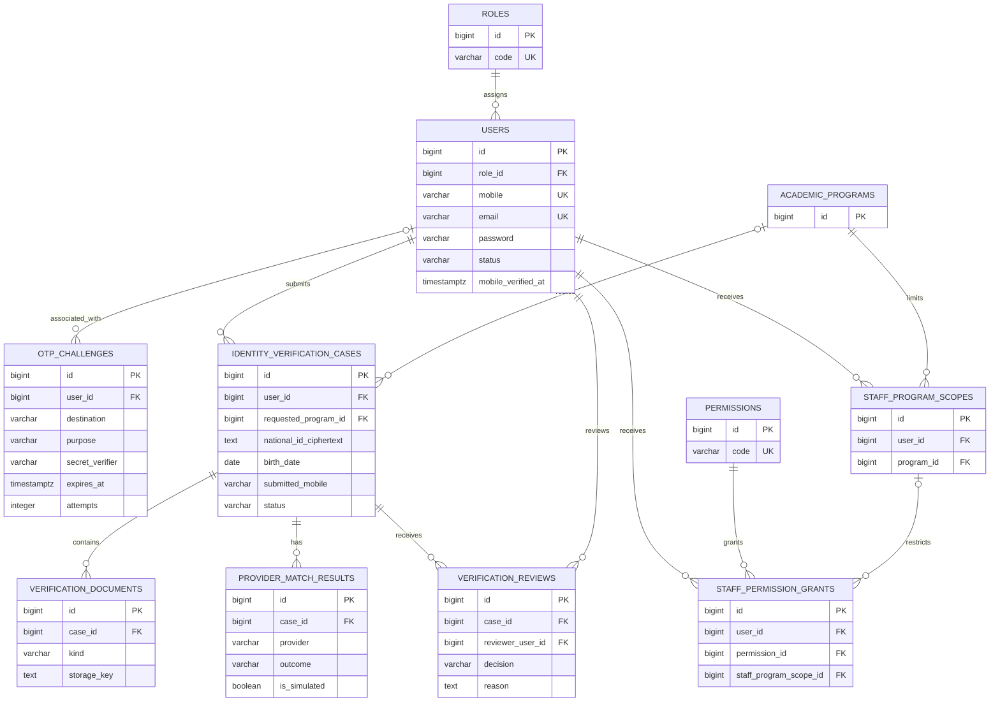

# University — Identity & Authorization ERD

- **Baseline:** University Architecture v1.0
- **Phase:** 00 — Architecture & Foundation / Identity & Authorization ERD (Day 1)
- **Status:** Proposed logical ERD and preliminary PostgreSQL physical design for review; not migration-ready
- **Target:** PostgreSQL 17, Laravel 13
- **References:** [Domain model](../../architecture/identity-authorization-domain-model.md), [Module boundaries](../../architecture/module-boundaries.md), [Business rules](../../requirements/business-rules.md), [Project scope](../../requirements/project-scope.md), [ADR-001](../../adr/0001-adopt-modular-monolith.md), [Roadmap](../../university-roadmap.md)

## 1. Scope and decisions

Translate the previously proposed domain model into relational storage without introducing unnecessary tables for value objects or framework services. Business rules are normative; physical names, types, nullability where requirements are open, state codes, indexes and policies are proposals. No migration, seed, API or test implementation is delivered here.

- **Confirmed:** exactly one primary role per account; six approved role categories; granular staff permissions and program-scoped Education/Support; protected verification documents; national-ID/mobile matching plus authorized document review; no public privileged registration.
- **Proposed:** Laravel `users` table represents the Account entity. `users.role_id` is a mandatory FK to `roles`, not a many-to-many pivot. Authorization owns role assignment semantics, while Identity owns account attributes. A provisioning workflow inserts the user with a trusted role in one transaction; Identity does not import Authorization internals.
- **Proposed:** a verification case represents one submission version. After submission, identity facts and document references are immutable; new evidence/review records may be appended. Resubmission would create a new case if approved as a product policy.
- **Proposed:** scope grants permit a collection of programs, pending OD-002. Permission grants can be attached to a particular program scope rather than combining unrelated permission and program grants. Global grants are restricted to actions explicitly classified as global in the future permission matrix; missing scope is never an implicit global grant.
- Academic owns `academic_programs` and student/teacher membership/history. It is shown as an external reference only; do not build a duplicate table in Identity or Authorization. Phase 01 requires a minimal real program reference migration/seed before dependent FKs; the complete Academic model follows in Phase 02.

## 2. Logical ERD

PK = primary key, FK = foreign key, UK = unique key. Cardinalities describe stored relationships, not whether a draft is ready for submission or a grant is eligible for a particular role.



`OTP_CHALLENGES.user_id` may be null for pre-registration. `requested_program_id` may be null for a draft under the proposed routing design, but is required before submission if OD-001 confirms it. Program IDs in the diagram are placeholders for the Academic identifier convention. Reviewers are accounts; Education role, capability and scope are checked by policy and workflow, not implied by the FK. Optional permission scope denotes a candidate global grant only when allowed by the action matrix; it is not a wildcard. The permission grant has a composite FK to its scope to prevent linking a different user's scope (section 4).

## 3. Preliminary physical data dictionary

Conventions: proposed `bigint GENERATED BY DEFAULT AS IDENTITY` or Laravel's equivalent bigint auto-generated PK; use the same type for corresponding FKs. PostgreSQL `bigint` is signed. `timestamptz` for instants, `date` for birth date; UTC handling and database conventions finalized on Day 3. `varchar` lengths are deliberately deferred until identifier normalization and provider requirements are reviewed. Default application timestamps follow Laravel conventions unless specified. `NN` = not null; `?` = nullable (including explicitly provisional choices). No national ID, mobile, or OTP secret stored as an integer. No actual credentials in examples.

### 3.1 Identity-owned records

| Table | Columns (preliminary) | Integrity and lifecycle |
|---|---|---|
| `users` | `id bigint PK`, `role_id bigint NN FK`, `name varchar ?`, `mobile varchar ? UK`, `email varchar ? UK`, `password varchar ?`, `status varchar NN`, `mobile_verified_at timestamptz ?`, `email_verified_at timestamptz ?` if used, `created_at`, `updated_at`; optional framework `remember_token` | Normalized login identifiers unique when present; student mobile required by registration workflow. Password contains framework hash only. Required name, identifiers/password per role, contact changes and status semantics open; no assumption OTP-only staff access is approved. Account availability separate from mobile and identity verification. |
| `otp_challenges` | `id bigint PK`, `user_id bigint ? FK`, `destination varchar NN`, `purpose varchar NN`, `context_id varchar NN` (opaque pre-registration or flow binding), `secret_verifier varchar ?`, `issued_at timestamptz NN`, `expires_at timestamptz NN`, `attempts integer NN DEFAULT 0`, `consumed_at timestamptz ?`, `invalidated_at timestamptz ?` | Check expiry > issue time, attempts >= 0, consumed and invalidated mutually exclusive; terminal times cannot precede issuance. Expiry derived from clock, not a permanent `expired` flag. Use keyed verifier bound to challenge/purpose/context, constant-time comparison; clear verifier on consumption/invalidation and purge expired secrets by retention policy. One-time verification enforced atomically. Limits/purpose codes/resend policy open. |
| `identity_verification_cases` | `id bigint PK`, `user_id bigint NN FK`, `requested_program_id bigint ? FK`, `national_id_ciphertext text ?`, `birth_date date ?`, `submitted_mobile varchar ?`, `status varchar NN`, `submitted_at timestamptz ?`, `decided_at timestamptz ?`, `created_at`, `updated_at` | Draft may be incomplete. Proposed states `draft`, `submitted`, `approved`, `rejected`; submitted facts must be complete, final states require submission and decision times; immutable submission snapshot enforced by workflow. No unique national-ID constraint on case history. National-ID cross-account uniqueness/retention undecided. Encrypt sensitive identity values; birth date shown as logical date and at-rest representation subject to privacy review. |
| `verification_documents` | `id bigint PK`, `case_id bigint NN FK`, `kind varchar NN`, `storage_key text NN`, `mime_type varchar NN`, `size_bytes bigint NN`, `created_at` | Unique (`case_id`, `kind`) for one file per kind per submission; proposed kinds `national_id_image`, `latest_diploma_image`. Size > 0; validate type, actual content and size in application. No public URL; draft replacement policy and cleanup of orphaned storage objects required. Submission requires both kinds. |
| `provider_match_results` | `id bigint PK`, `case_id bigint NN FK`, `provider varchar NN`, `outcome varchar NN`, `is_simulated boolean NN`, `provider_reference varchar ?`, `checked_at timestamptz NN` | Append evidence only for an immutable submitted snapshot. Proposed outcomes `matched`, `mismatched`, `unavailable`, `error`; no record = not checked. Preserve provenance, no raw provider payload by default. Mock evidence cannot support real production approval. Retry/freshness/authoritative result policy must be agreed. |
| `verification_reviews` | `id bigint PK`, `case_id bigint NN FK`, `reviewer_user_id bigint NN FK`, `decision varchar NN`, `reason text ?`, `reviewed_at timestamptz NN` | Append-only review history. Proposed decisions `approved`, `rejected`; nonblank rejection reason required; approval reason policy open. Reviewer must hold valid Education role, permission and routing scope. Approval review is distinct from final case approval, which requires valid matching evidence. |

The case status is the workflow decision; provider outcome and manual review remain independent evidence. A manual approval alone does not mean identity is verified. A finalization operation locks the case, rechecks status, actor access, both documents, evidence for the same immutable submission and validity of manual decision. It records terminal outcome and audit atomically; external provider calls/uploads are outside long-lived transactions. Once finalized, competing requests cannot overwrite the decision. If later evidence arrives, it must not silently modify a final outcome. Define which case is currently effective and contact-change/reverification policy before enrollment integration; do not infer current identity approval from any historical approved case. Do not add a redundant `users.is_verified` flag now.

### 3.2 Authorization-owned records

| Table | Columns (preliminary) | Integrity and lifecycle |
|---|---|---|
| `roles` | `id bigint PK`, `code varchar NN UK`, `name varchar NN`, timestamps | Seed stable codes: `student`, `teacher`, `education`, `store_management`, `site_admin`, `support`; proposed check/controlled catalog of these six codes. No public role creation or arbitrary privileged role selection. |
| `permissions` | `id bigint PK`, `code varchar NN UK`, `description text ?`, timestamps | Stable capability codes, e.g. `identity.verification.review`; final matrix and role eligibility Day 3. Permission existence alone does not imply role eligibility. |
| `staff_program_scopes` | `id bigint PK`, `user_id bigint NN FK`, `program_id bigint NN FK`, timestamps | Unique (`user_id`, `program_id`); unique (`id`, `user_id`) as target for composite grant FK. A scope is not academic membership and grants no capability alone. Number of scopes and allowed roles remain open. |
| `staff_permission_grants` | `id bigint PK`, `user_id bigint NN FK`, `permission_id bigint NN FK`, `staff_program_scope_id bigint ? FK`, timestamps | FK (`staff_program_scope_id`, `user_id`) → `staff_program_scopes(id, user_id)` with default MATCH SIMPLE (null scope allowed only for explicitly global actions). Proposed `UNIQUE NULLS NOT DISTINCT (user_id, permission_id, staff_program_scope_id)` on PostgreSQL 17; prevents repeated global/scoped grants. Role/capability and scope-requiredness enforced in service/policy. |

Permission model is provisional: explicit grants, no default role-permission bundles, no negative overrides or expiry in this draft. If Day 3 confirms role defaults or program-independent permission bundles, revise the model before migration. A role/permission allowlist and which actions require scope are normative policy decisions, not inferred from nullable columns. Granting authority, revocation audit and role changes remain open. A revoked scope must stop access immediately; proposed delete/revoke workflow atomically removes active dependent grants and records audit history. No retained stale grants in authorization queries. Use FK RESTRICT by default to make removal explicit.

## 4. Constraints and enforcement boundaries

| Invariant | Mechanism |
|---|---|
| Exactly one primary role (BR-IDN-001) | `users.role_id NOT NULL` + FK; trusted provisioning selects a valid role. No role pivot required. |
| Unique mobile/email login | Canonicalize on every write and lookup, then unique constraints for non-null identifiers. Email case policy and mobile format must be consistent; multiple nulls remain allowed. |
| No repeated scope | `UNIQUE(user_id, program_id)`. |
| No grant using another user's scope | Composite FK `(staff_program_scope_id, user_id)` to `(id, user_id)`; do not use only scope-ID FK. |
| No duplicate grants | `UNIQUE NULLS NOT DISTINCT (user_id, permission_id, staff_program_scope_id)`; PostgreSQL 17 syntax, migration approach later. |
| Valid row values | CHECK for proposed status/purpose values once approved, OTP time/attempt rules, document kind and positive size, rejection reason and valid case timestamps. CHECK is not a cross-table or dynamic expiry mechanism. |
| Case submission completeness | Application workflow with transaction and locked case; checks required facts and both document rows. A per-document unique key alone does not enforce both documents exist. |
| Legitimate review / grant / teacher creation | Policies and application services verify authenticated actor, role, explicit permission, relevant scope, account and resource state. FKs do not enforce actor permission. |
| Both matching and manual approval | Application transaction revalidates evidence from same submission and authorized review; finalization is idempotent/conflict-safe. |
| Single OTP consumption | Conditional atomic update or row lock + update inside transaction; recheck expiry and attempts after locking, update failed attempts safely. Do not use read-then-write without concurrency control. |
| No accidental history deletion | Historical references use `ON DELETE RESTRICT`/`NO ACTION` by default. No cascading deletion of academic, identity or review records. Explicit privacy/retention workflows handle permitted erasure. |

PostgreSQL CHECK conditions accepting NULL require explicit NOT NULL where required; for conditional completeness use explicit `IS NOT NULL` checks. CHECK does not guarantee current time or facts in other tables. Do not use a CHECK querying another table. Cross-table invariants are enforced transactionally and tested; consider DB triggers only if a concrete integrity requirement cannot be met safely otherwise.

### Illustrative PostgreSQL fragments (not runnable migrations)

```sql
-- One primary role per account; roles must already exist.
role_id bigint NOT NULL REFERENCES roles(id) ON DELETE RESTRICT

-- Scope uniqueness and ownership key.
UNIQUE (user_id, program_id),
UNIQUE (id, user_id)

-- Permission-grant table constraints (scope FK may be NULL).
FOREIGN KEY (staff_program_scope_id, user_id)
    REFERENCES staff_program_scopes(id, user_id) ON DELETE RESTRICT,
UNIQUE NULLS NOT DISTINCT (user_id, permission_id, staff_program_scope_id)
```

If a grant references scope A owned by staff B but specifies staff C, the composite FK rejects it. A null scope is still subject to application-level role/action rules. Do not infer global authorization from absence of a scope. No PostgreSQL row-level security is selected by this draft; Laravel server-side policies and scoped queries remain mandatory.

## 5. Initial index plan

Primary keys and unique constraints already create indexes in PostgreSQL. Foreign keys do not automatically create indexes on referencing columns. Add indexes based on actual query and FK maintenance needs; avoid duplicates. Candidate indexes (subject to measurement):

| Table | Candidate index | Workload |
|---|---|---|
| `users` | `(role_id)` | Role filtering / FK checks |
| `otp_challenges` | `(destination, purpose, issued_at DESC)` | Latest challenge/resend lookup; use trusted flow context in queries |
| `otp_challenges` | `(user_id)`; `(expires_at)` | Account lookup/FK; cleanup |
| `identity_verification_cases` | `(user_id, created_at DESC)` | Student case history |
| `identity_verification_cases` | `(requested_program_id, status, submitted_at)` | Scoped Education review queue |
| `verification_documents` | `UNIQUE(case_id, kind)` only initially | Case documents; no redundant case-only index |
| `provider_match_results` | `(case_id, checked_at DESC)` | Evidence history |
| `verification_reviews` | `(case_id, reviewed_at DESC)`; `(reviewer_user_id)` | Review history and reviewer lookup |
| `staff_program_scopes` | `UNIQUE(user_id, program_id)`; `(program_id)` if needed | Actor scopes and program lookup |
| `staff_permission_grants` | Unique grant index; `(staff_program_scope_id, user_id)`; `(permission_id)` if needed | Authorization by actor, FK maintenance and permission lookup |

A proposed partial unique index for one open case per account (`WHERE status IN ('draft','submitted')`) is **not** selected until resubmission/concurrent case policy is approved. Do not make `now()`-dependent predicates for OTP validity. Verify representative queries using `EXPLAIN (ANALYZE, BUFFERS)` on synthetic data in a safe isolated database when features exist.

## 6. Normalization and framework integration

- Keep roles and permissions as independent catalogs; avoid repeating role/permission descriptions in users or storing comma-separated permission/program IDs.
- Store program membership in Academic; no `users.program_id` shortcut or duplicate staff affiliation.
- Separate cases, documents, provider evidence and reviews for independent history and one-to-many relations. Submitted mobile is a deliberate snapshot, not a normalization mistake; do not overwrite it when users change mobile.
- No separate table for each Value Object. Credentials and verified-at timestamps can live on `users`; no separate mobile verification table unless behavior requires it.
- Existing Laravel default `users` migration is a starting point only. Review its name/email/password requirements and migration ordering; do not assume its current fields satisfy approved login rules.
- `sessions`, `password_reset_tokens`, queue/cache tables and migration history are framework/infrastructure tables, outside the ten domain tables. Select session/reset persistence with Sanctum and account recovery implementation; review their actual FK/index conventions separately. Use secure session cookies, CSRF and safe logout/revocation. Do not add a personal access tokens table merely to demonstrate first-party cookie authentication.
- Treat national ID, birth date, mobile and document metadata as sensitive. Never use actual identities in public demos or CI. Apply least-privilege access, encryption/key handling, safe logs and authorized private file serving. If national-ID equality lookup becomes necessary, design a keyed fingerprint and uniqueness policy separately; randomized ciphertext cannot enforce semantic uniqueness.

## 7. Suggested migration dependency order (Phase 01, not now)

1. Review identifier conventions and existing Laravel migrations. Create stable `roles` and seed/reference the six approved codes before provisioning accounts.
2. Create/adapt `users` with mandatory `role_id` FK; no backfill assumptions for an existing database. In a populated environment use a reviewed expand/backfill/validate sequence.
3. Create the minimal Academic-owned `academic_programs` reference only after Academic design is reviewed; do not duplicate it or introduce a temporary unvalidated program field as a production FK substitute.
4. Create `permissions`, `staff_program_scopes`, then `staff_permission_grants`.
5. Create `otp_challenges`, `identity_verification_cases`, `verification_documents`, `provider_match_results`, `verification_reviews` respecting parent dependencies.
6. Add reviewed constraints/indexes, framework tables and synthetic fixtures as necessary; verify both migration and safe rollback in an isolated PostgreSQL database. Do not run destructive migration commands against development or production data.

## 8. Acceptance evidence for implementation

| Rule / concern | Automated test cases |
|---|---|
| BR-IDN-001/002 | Null/invalid role rejected by database; duplicate normalized identifier rejected; student public role injection denied; atomic provisioning rollback; teacher creation denied outside authorized scope. |
| BR-IDN-003 | OTP before account exists; expiry, wrong purpose/context, replay and concurrent consumption; atomic attempts; credential modes and contact verification. |
| BR-IDN-004/005/006 | Missing required docs; duplicate document kind; mismatch/unavailable and simulated production evidence denied; wrong-scope reviewer denied; historical snapshot immutable; concurrent finalization; private file authorization. |
| BR-AUT-001/002 | Duplicate grant/scope rejected; cross-user scope FK rejected; missing scope denied; unrelated program's permission not combined with another scope; CMS or Support cannot review identity; revoke scope denies access. |
| BR-ENR-001 | Verified mobile alone insufficient for enrollment; historical approval cannot automatically override current verification policy. |
| Privacy and integrity | Restricted historical deletes; no credentials/OTP/identity data in logs or public responses; mock provider only in approved environments. |

These are future acceptance requirements, not test results. Write required backend/frontend tests with implementation in the same step/PR. Use isolated PostgreSQL for database constraints, transactions and real concurrency; use separate connections/processes and synthetic fixtures. Current dev testing isolation and frontend build verification are outstanding Foundation items. No application behavior changed here, so no application tests were executed for this document.

## 9. Open decisions before migration freeze

| Decision | Resolve before |
|---|---|
| Identifier type, timestamp convention, deletion/retention, sensitive-field encryption | Day 3 / Phase 01 migration |
| OD-001: initial program routing, membership activation, teacher/staff provisioning | Phase 01 workflow |
| OD-002: scope cardinality, role/permission matrix, grant authority, per-program vs global permissions, revocation history | Day 3 / Phase 01 authorization |
| Required contact/name/password by role, email normalization, contact changes, suspension and role changes | Phase 01 account migration/workflow |
| OTP expiry, resend, attempt limits, purpose/context and retention | Phase 01 OTP |
| Case resubmission and effective approval, duplicate national IDs across accounts, evidence freshness, document retention | Phase 01 verification |
| API.ir/SMS availability, handling provider failure, no unauthorized fallback; real/fake evidence isolation | Before live integration / Phase 01 |

Review this ERD alongside the Domain Model; revise both documents together if decisions change. Academic relationships and the final permission matrix follow in the remaining Foundation days. No schema or application changes are authorized solely by this draft.


## 10. Phase 01.02 — Implemented Schema Baseline

The implemented Identity and Authorization schema contains ten domain tables and one Academic-owned reference table.

### Implementation decisions

- PostgreSQL 17 is the target database.
- Laravel bigint identifiers are used for primary and foreign keys.
- Each user has exactly one primary role.
- Historical relationships use restrictive deletion rules.
- Staff permission grants support scoped and explicitly global representations.
- Composite foreign keys prevent grants from referencing another user's program scope.
- PostgreSQL UNIQUE NULLS NOT DISTINCT prevents duplicate global and scoped grants.
- OTP contexts use UUID identifiers.
- OTP purposes are currently registration and login.
- Non-terminal OTP challenges require a secret verifier.
- Consumed or invalidated OTP challenges must not retain their verifier.
- Expired OTP cleanup remains an application workflow responsibility.
- Identity verification cases support draft, submitted, approved, and rejected states.
- National identity numbers use Laravel encrypted casts.
- Verification documents store private storage keys rather than public URLs.
- Provider results distinguish real evidence from simulated evidence.
- Manual review decisions are independent of final verification status.
- Rejected reviews require a nonblank reason. Approval reasons are optional.
- Case history uses the composite user_id and created_at index.

### Enforcement boundaries

The database enforces structural integrity and row-level constraints. Application services and authorization policies must enforce role eligibility, scope requirements, OTP consumption, replay protection, private file access, submission immutability, evidence validity and atomic verification finalization.

### Migration safety

The schema hardening migration removes retained verifiers from legacy terminal OTP challenges.

Previously removed verifiers must not be restored. Rolling back to the former non-nullable verifier schema is prohibited while records containing cleared verifiers exist.

The users migration also requires an explicit backfill strategy when applied to a populated legacy database.

Destructive migration lifecycle tests must run only against the isolated PostgreSQL testing database.